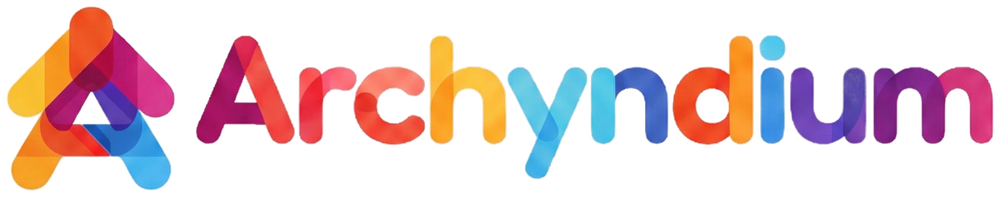
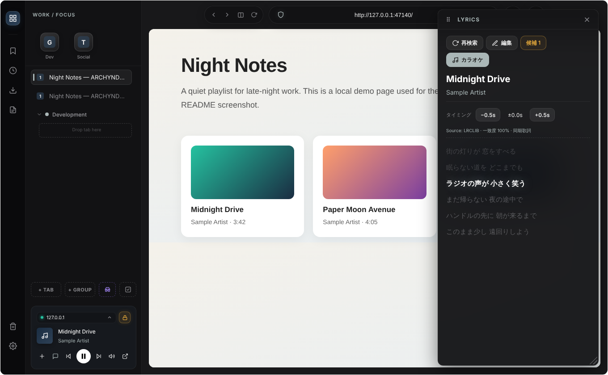
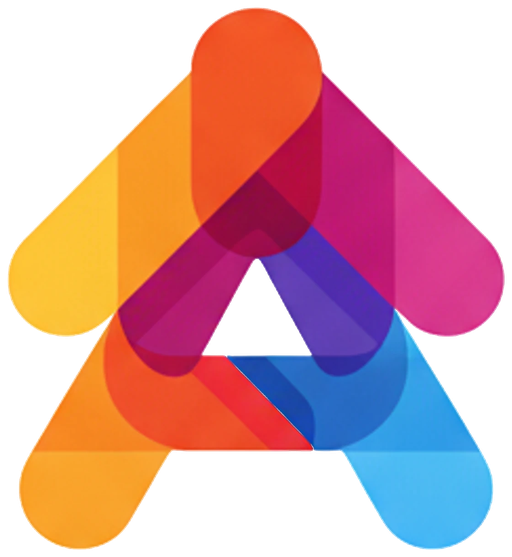

<p align="center">
  
</p>

<p align="center">
  
</p>

<h1 align="center">ARCHYNDIUM Browser</h1>

<p align="center">
  音楽と歌詞を楽しみながら使える、デザイン重視のデスクトップブラウザ<br>
  A design-focused desktop browser with a built-in music player and synced lyrics.
</p>

<p align="center">
  <a href="https://github.com/archyndium/archyndium-browser/releases/latest">ダウンロード</a> ·
  <a href="#主な機能">機能</a> ·
  <a href="#ソースから動かす">開発</a> ·
  <a href="LICENSE">GPLv3</a>
</p>



## 主な機能

**ブラウジング**
- サイドバーのタブ一覧・グループ・ピン留め、Work / Focus（よく使うサイトをアプリのように並べるフォルダ）
- 分割表示（2 つのページを左右・上下に並べる）、複数ウィンドウ、タブをウィンドウの外へドラッグして別ウィンドウに
- タブの複数選択とまとめて閉じる（元に戻せる）、閉じたタブの復元、セッションの復元
- アドレスバーで検索（検索エンジンを選択可）、ページ内検索、ズーム、リーダーモード、翻訳、PDF の表示と保存
- コマンドパレット（すべての操作をキーボードから）、メモ、ブックマーク（他のブラウザから取り込み可）、履歴、ダウンロード管理
- シークレットモード（専用の検索エンジンを選べる・追跡拒否の合図を送る）、12 種類のテーマ（落ち着いた明るいテーマ 3 種類を含む）
- タブ・リンクにマウスを乗せるとプレビュー、コピー禁止のページのコピー制限を解除・文字の取り出し
- タブを上に並べる・サイドバーに並べるの切り替え（設定 → Layout）
- 季節の演出：音楽の再生中、タブバーに雪・桜・雨・落ち葉が降って積もる（設定 → 演出で調整・オフ。OS の「視差効果を減らす」に従って自動で停止）

**音楽**
- 再生中のタブ（動画サイト・音楽サイト）やローカルの音楽ファイルをサイドバーから操作
- 歌詞の自動表示とカラオケ表示（再生位置に合わせて行がハイライト、タイミング調整を曲ごとに記憶）
- マイ歌詞：自分の .lrc / .txt ファイルを読み込んだり、歌詞エディタで曲を聴きながら Space キーでタイミングを付けて作ったりできます（.lrc で書き出し可）
- いつも手前に表示されるミニプレイヤー、イコライザー

**安全・プライバシー**
- 広告ブロック：標準・簡易・オフの 3 つのモード（サイトごと・タブごとに切り替え。動画・音楽サイトでは自動で「簡易」）
- サイトの権限（カメラ・マイク・位置情報・通知）を確認してから許可
- ページとブラウザ本体を分離（サンドボックス・IPC の送り主チェック・Content Security Policy）
- 実行ファイルを開く前の確認、Windows の「インターネットから来たファイル」の印（SmartScreen 対応）

**拡張機能**
- Chrome ウェブストアの拡張機能を追加できます（Electron が対応している機能の範囲で動作します）

## ダウンロード

> **Code signing:** Windows installers are currently **not code-signed**.
> We plan to reapply to the [SignPath Foundation](https://signpath.org/) free code signing program
> as the project grows. See our [code signing policy](docs/CODE_SIGNING_POLICY.md).

[Releases](https://github.com/archyndium/archyndium-browser/releases/latest) から `ARCHYNDIUM-Browser-Setup-x.x.x.exe` をダウンロードして実行してください。
インストール後は、新しい版が出ると自動でアップデートされます。

- 対応 OS：Windows 10 / 11（64 ビット）

### 「Windows によって PC が保護されました」と表示された場合

現在のインストーラーには**コード署名がありません**（[SignPath Foundation](https://signpath.org/) の無料署名に、プロジェクトが育ってから再申請する予定です）。
そのため、ダウンロードや実行の時に次の警告が出ることがあります。どれも「発行元を確認できない新しいファイル」に出る警告で、
ファイルが壊れている・危険だと判定されたわけではありません。

1. **ブラウザ（Edge など）でダウンロードした時**
   「一般的にダウンロードされていません」と出たら、ファイル名の横の「…」から「保存」（または「保持する」）を選び、続けて出る画面で「詳細表示」→「保持する」を選びます。
2. **インストーラーを実行した時**
   青い画面で「Windows によって PC が保護されました」と出たら、**「詳細情報」**を押し、表示された**「実行」**を押します。

心配な場合は、ダウンロードしたファイルが本物か確かめてから実行してください。
Releases の `SHA256SUMS.txt` に書かれた値と、次のコマンド（PowerShell）の結果が同じなら、配布したものと同じファイルです。

```powershell
Get-FileHash .\ARCHYNDIUM-Browser-Setup-0.1.0.exe -Algorithm SHA256
```

コード署名の方針は [コード署名ポリシー](docs/CODE_SIGNING_POLICY.md) をご覧ください。

## このブラウザでできないこと

Netflix などの著作権保護（DRM）付きの動画・音楽、Google アカウントでの同期、パスワードの自動入力、
Chromecast などは、Electron の仕組み上使えません。詳しくはアプリの「設定 > このブラウザでできないこと」をご覧ください。

## 外部への通信とプライバシー

ARCHYNDIUM Browser は利用状況の収集（テレメトリ・解析）を行いません。表示中のページ以外に通信するのは次の場合だけです（詳しくは [プライバシーポリシー](PRIVACY.md)）。

| 通信先 | いつ | 目的 |
|---|---|---|
| 選んだ検索エンジン | アドレスバーに入力した時（シークレットタブを除く。設定でオフにできます） | 検索候補の表示 |
| リンク先のサイト | リンクにマウスを乗せた時（Cookie は送りません。シークレットタブを除く。設定でオフにできます） | リンクのプレビュー |
| LRCLIB（lrclib.net） | 曲の歌詞を表示する時（マイ歌詞がある曲は通信しません） | 歌詞の取得 |
| YouTube oEmbed | 動画サイトで曲が変わった時 | 曲名の取得 |
| GitHub（raw.githubusercontent.com） | 起動時 | 広告ブロック用フィルターリストの取得 |
| GitHub Releases | 起動時と 6 時間ごと | アップデートの確認 |
| Chrome ウェブストア | 拡張機能を追加する時だけ | 拡張機能のダウンロード |

## 歌詞について

歌詞は次のどちらかを表示します。

1. **マイ歌詞** … 利用者自身が読み込んだ .lrc / .txt ファイル、または歌詞エディタで作った歌詞。
   その PC の中だけに保存され、どこにも送信しません。マイ歌詞がある曲ではこちらを優先します。
2. **LRCLIB** … [LRCLIB](https://lrclib.net/) の公開データベース（利用者が投稿したもの）から取得して表示します。

歌詞の著作権は各権利者に帰属します。本アプリは歌詞を同梱・配布しません。

**歌詞エディタの使い方**：歌詞パネルの「マイ歌詞」→「歌詞を作る」→ 歌詞を貼り付けて「タイミングを付ける」→
曲を再生しながら、各行の歌い出しで Space キー（Backspace で 1 行戻る）→「保存して表示」。

## ソースから動かす

必要なもの：[Node.js](https://nodejs.org/) 22 以上

```bash
npm ci          # 依存パッケージを入れる
npm start       # 開発モードで起動
npm run check   # 全ファイルの構文チェック
npm run dist    # Windows 用インストーラーを dist/ に作る（Windows で実行）
npm run icons   # build/icon.svg からアイコン一式を作り直す
```

### フォルダ構成

```
src/
  main.js            メインプロセスの入口
  main/              メインプロセスの機能（ウィンドウ・ダウンロード・Shield・拡張機能・更新 など）
  preload.js         画面とメインプロセスをつなぐ窓口
  index.html         ブラウザ本体の画面
  renderer/          画面側の機能（タブ・プレイヤー・歌詞・設定 など）
  mini-player.html   ミニプレイヤー
build/               アイコン（元データ icon.svg と、npm run icons で作る各サイズ）・Microsoft Store 用の画像
scripts/             構文チェック・ライセンス一覧の作成
docs/                リリース手順・スクリーンショット
```

リリースの手順は [docs/RELEASING.md](docs/RELEASING.md) にまとめています。

## 支援

開発を応援していただける方は、[GitHub Sponsors](https://github.com/sponsors/archyndium) からご支援いただけるとうれしいです。
Microsoft Store 版（有料）の購入も開発の支えになります。

## ライセンス



Copyright © 2026 archyndium<br clear="left">

ソースコードは [GNU General Public License v3.0](LICENSE)（GPLv3）で公開しています。
GPLv3 の条件のもとで自由に利用・改変・再配布できます。改変したものを配布する場合は、そのソースコードも GPLv3 で公開する必要があります。

**「archyndium」の名称・ロゴは作者のみ使用可**です。改変版を配布する場合は、別の名前とロゴに変更してください。
ロゴ画像（`build/` 内のアイコンと `src/assets/brand/` 内の会社ロゴ）は GPLv3 の対象外です。詳しくは [TRADEMARKS.md](TRADEMARKS.md) をご覧ください。

利用しているオープンソースソフトウェアのライセンスは [THIRD_PARTY_NOTICES.md](THIRD_PARTY_NOTICES.md) を参照してください。
YouTube・Chrome・Netflix などの名称は各社の商標です。本アプリはそれらの会社とは関係ありません。
